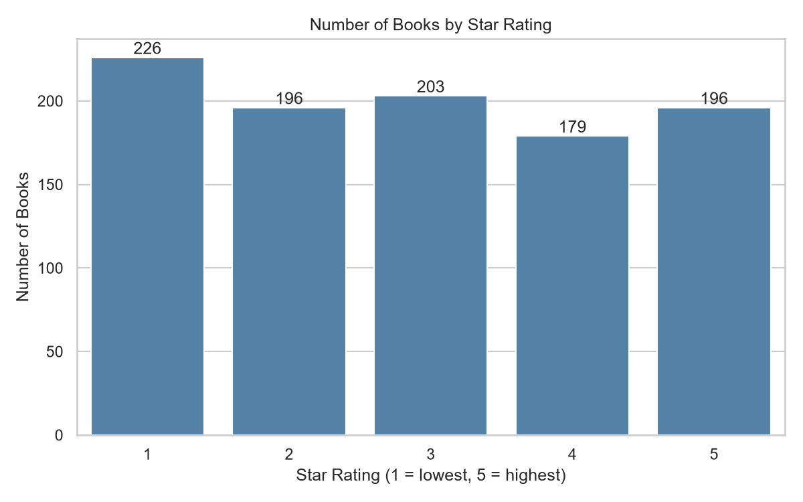
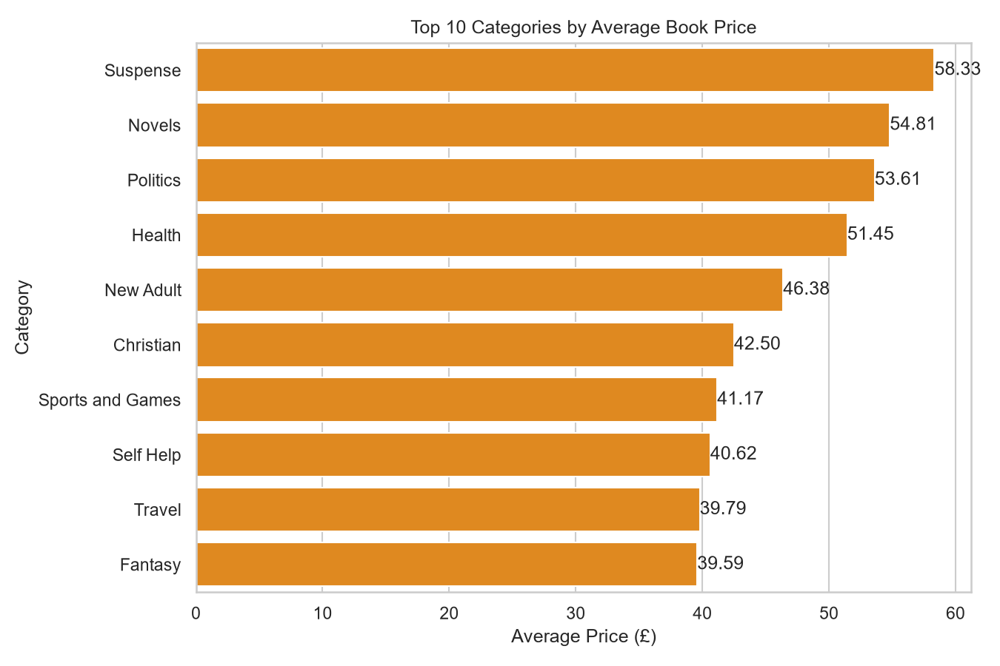
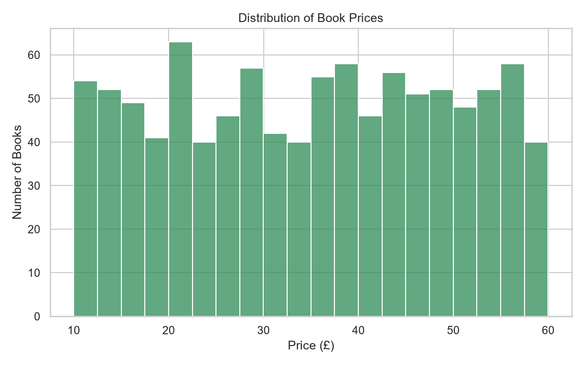

# CodeAlpha_WebScraping

Online Book Catalogue Scraper and Price Analysis
Task 1 of the CodeAlpha Data Analytics Internship.

## Objective
Collect book data from a public practice website, clean it, save it as CSV
files, and analyse prices, ratings, categories and availability.

## Data Source
[Books to Scrape](https://books.toscrape.com/), a website made for practising web scraping.
The scraper reads robots.txt, uses a 0.5-second delay between requests, and
identifies itself with a User-Agent.

## Tools
Python, Requests, BeautifulSoup, Pandas, Matplotlib, Seaborn (VS Code)

## Project Structure
```
CodeAlpha_WebScraping/
├── scraper.py          # scrapes, cleans and saves the data
├── analysis.py         # analysis and charts
├── requirements.txt
├── data/
│   ├── books_raw.csv
│   └── books_clean.csv
└── charts/
    ├── 01_rating_distribution.png
    ├── 02_top_categories_avg_price.png
    └── 03_price_distribution.png
```

## Methodology
1. Read the category list from the home page.
2. Visit each category and follow the "next" links (pagination).
3. Extract title, category, price, star rating, availability and product URL.
4. Handle request errors (timeouts, retries, HTTP errors).
5. Remove duplicates, convert price to a number and rating to 1-5.
6. Save raw and clean CSV files, then analyse and create charts.

## How to Run (Windows)
```
python -m venv venv
.\venv\Scripts\Activate.ps1
python -m pip install -r requirements.txt
python scraper.py
python analysis.py
```

## Dataset
`data/books_clean.csv`: [number] rows, 7 columns:
title, category, price_gbp, rating, availability, in_stock, product_url

## Key Findings
(from my own run of the scripts)
- [Finding 1, e.g. average and median price]
- [Finding 2, e.g. category with the highest average price]
- [Finding 3, e.g. correlation between price and rating]

## Charts




## Limitations
- Data comes from a practice website, not real market data.
- Only fields shown on the category listing pages were collected.
- The website layout could change and break the scraper.
